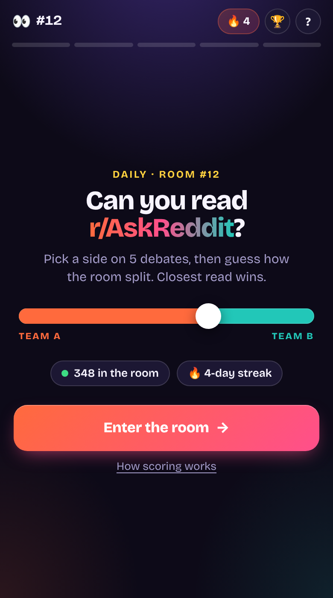
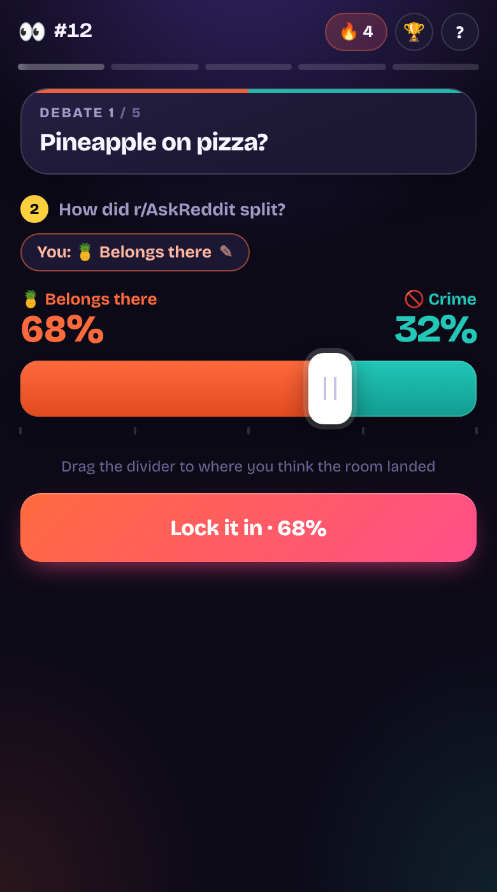
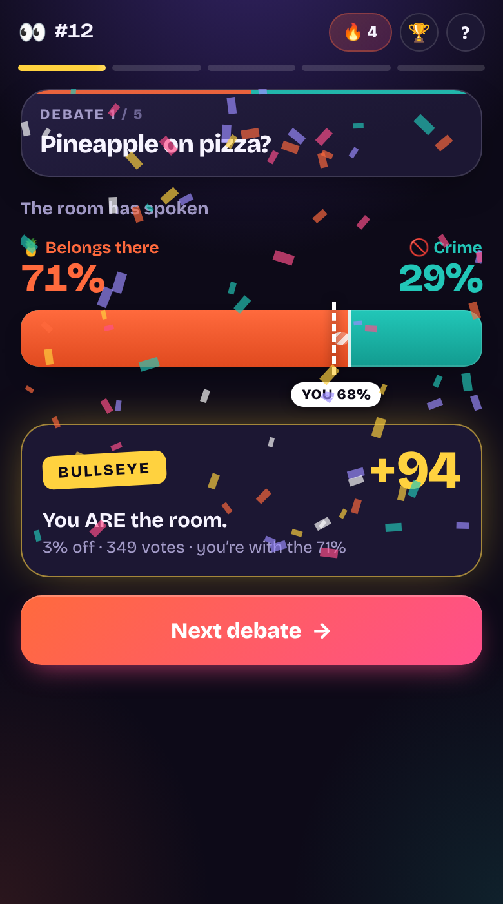
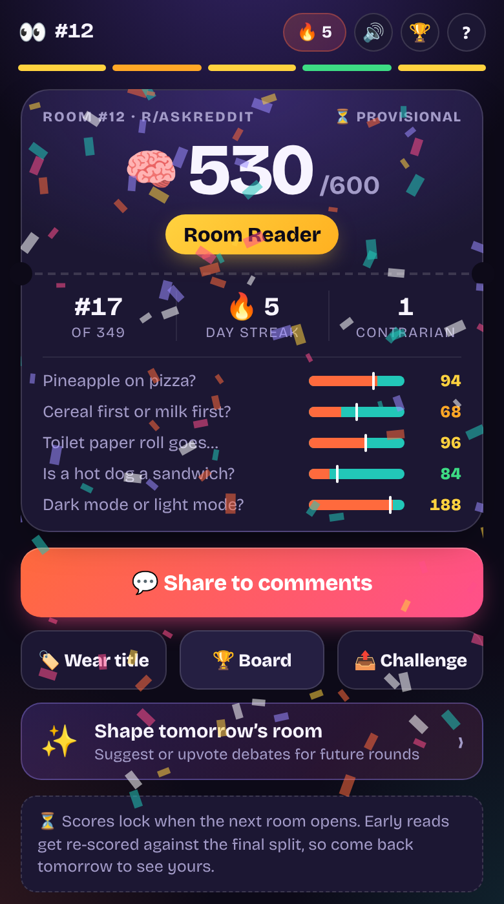

# 👀 Read the Room

**A daily Reddit game where you don't guess what's right. You guess what the subreddit thinks.**

Every day a new "room" opens with 5 quick debates (*Pineapple on pizza? Over or under?*).
For each one you:

1. **Pick your side.** Your honest vote becomes part of the room.
2. **Predict the split.** Slide to the % of the subreddit you think chose the left option.
3. **Get scored.** 100 points for a perfect read, −2 for every percentage point you're off. The 5th debate is the **👑 Final Boss**, worth double.

Finish all 5 to get your daily score out of 600, a title, and an emoji grid you can share.

<p align="center">
  
  
  
  
</p>

## Why it's built for Reddit

| Feature | How it uses Reddit |
|---|---|
| **The community is the answer key** | Every score is computed live against real votes from the subreddit, so no two communities play the same game. |
| **Mod-written debates** | Moderators add debates specific to their community from the subreddit menu (a native Reddit form). Mod picks get first priority in the next room and show a 📌 badge. |
| **Community-written prompts** | Players submit prompts and upvote each other's. The top-voted ones are featured in upcoming rounds and credited to their author. |
| **Share to comments** | One tap posts your result to the round's comment thread, so each day's post fills with friendly debate. |
| **Wear your title** | Set your subreddit user flair to your daily title + streak (e.g. `🔮 Mind Reader · 🔥7`). |
| **Streaks & leaderboards** | Per-room, all-time and **🙃 Contrarians** boards (most picks against the majority), plus 🔥 daily streaks. |
| **Challenge a friend** | Native Reddit share sheet with your score and emoji grid. |
| **Yesterday's Verdict** | Each new room opens with the previous room's final splits, its most divisive and most one-sided debates, and the best readers. |
| **Pinned results thread** | When a room closes, the app pins a "📊 The room has spoken" comment with every final split, turning each post into a discussion thread. |
| **Fully automatic** | A scheduled job posts a new round every day at 12:00 UTC. |

## Scoring

| Grade | Points per prompt |
|---|---|
| 🎯 Bullseye | 94–100 |
| 🟩 Close | 75–93 |
| 🟨 Off | 45–74 |
| 🟥 Miss | 0–44 |

**Daily titles (out of 600):** 🔮 Mind Reader (540+) · 🧠 Room Reader (456+) · 📡 Vibe Checker (360+) · 🌶️ Hot Take Haver (240+) · 🙃 Certified Contrarian. Grades are based on accuracy, so a Final Boss bullseye is still a 🎯.

**Final scoring:** your score is *provisional* while the room is open. When the next room opens, every player is re-scored against the room's **final** split, the leaderboards are updated, and the new post shows your locked score (with ▲/▼ versus provisional). Early players aren't punished for reading a small room, and everyone has a reason to come back.

**Small rooms:** the first few players of a round would otherwise be scored against just 1–2 votes. To prevent that, the score adds 4 virtual votes split 50/50, and their effect fades as real votes arrive. Players always see the raw percentage.

**Fair play:**
- Answers are write-once on the server, so a double tap can't count a vote twice.
- You can't see the split until you've locked in your guess.
- Streaks only count on the current day's round.

## For moderators

After installing the app:
- The first round is posted automatically, and a new one every day at 12:00 UTC.
- **Subreddit menu → "Read the Room: post today's round"** posts a round immediately (and closes the previous one).
- **Subreddit menu → "Read the Room: add a custom debate"** queues a debate written for your community. Up to 3 mod debates are used per room, oldest first.
- **Subreddit menu → "Read the Room: clear suggestion queue"** removes all pending community prompts.
- Community prompts are filtered (length, links, NSFW, and political topics). Each one needs upvotes before it can be featured.

## Tech

- **Devvit Web** with React 19 + TypeScript, built with Vite and `@devvit/start`
- **Server:** Devvit Node server with Redis (tallies, answers, leaderboards, streaks, suggestions), the Reddit API (posts, comments, flair) and the scheduler
- **Juice:** synthesized Web Audio sound effects (with a mute toggle), haptics, confetti and count-up animations; all respect reduced-motion
- **Tests:** `vitest` for scoring, Final Boss weighting, final re-scoring, streaks, moderation and the prompt bank

```
src/
  client/   React web view (game.html → App.tsx)
  server/   API routes, Redis store, prompt bank, moderation
  shared/   API contracts + pure scoring logic (used by both)
tests/      unit tests
```

## Run it

```bash
git clone https://github.com/MdIbuA/reddithackathon && cd reddithackathon
npm install
npm run login        # once: log in to Reddit
npm run setup        # once: build, register the app and create a test subreddit (devvit upload)
npm run dev          # playtest in your dev subreddit
npm test && npm run typecheck
npm run deploy       # upload a new version
```

## License

MIT. See [LICENSE](LICENSE).
